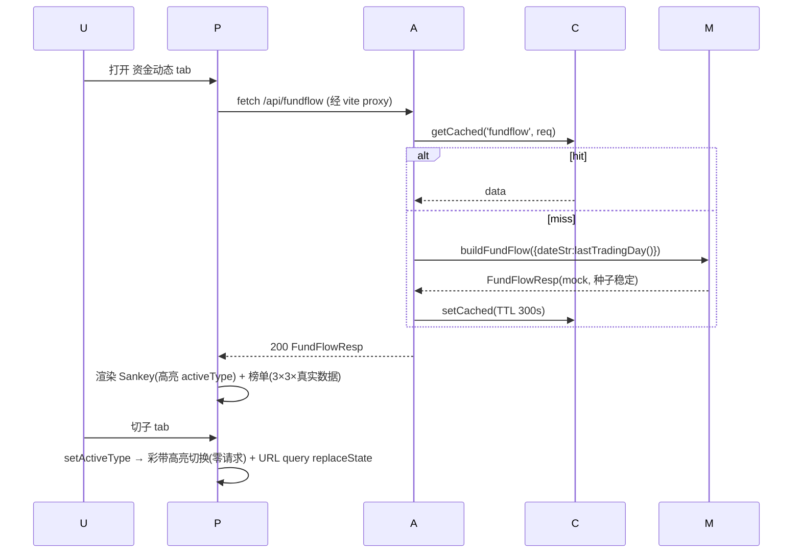

# 资金流向（资金动态）· 增量架构设计 v1.2

> 依据：`docs/PRD-资金流向-增量.md` **v1.2**（701+ 行）。
> 设计人：主理人齐活林兜底（原架构师因平台 429 限流未交付，本稿基于其任务上下文重构）。
> 基线：本地 HEAD `87b976c`（上游 a69fc43 已同步）。

---

## 1. 实现方案概述

```
┌───────────────────────── H5 (5173, uni-app vue3) ─────────────────────────┐
│ pages/fundflow/index.vue                                                  │
│   ├ HeroCard        ├ SubTabs(4+更多)   ├ DateBanner(日期+示意标注)        │
│   ├ SankeyChart(SVG)├ SankeyCTA         ├ RankBoard×2(sector/stock)        │
│   └ 状态: activeType/muted删除/加载/错误  (composable, 不引 pinia)          │
│           │ fetch /api/fundflow (src/api/fundflow.ts)                     │
└───────────┼───────────────────────────────────────────────────────────────┘
            │ vite proxy: /api → 9999 (server.proxy 已配)
┌───────────▼───────────────── Backend (9999, Express+tsx) ─────────────────┐
│ GET /api/fundflow  →  cache.getCached('fundflow', req)  (TTL 300s)        │
│       miss → buildFundFlow({ mode: FUND_FLOW_MODE })                      │
│              mode=mock(默认): 生成器(纯函数, 种子=YYYY-MM-DD)              │
│              mode=eastmoney/partner: throw 'not implemented'(501)         │
└───────────────────────────────────────────────────────────────────────────┘
```

**数据流**：前端一次拉全量（4 类资金的 sankey + 榜单），子 tab 切换**零请求**（纯前端高亮切换）；缓存 TTL 300s；`asOf` 用最近 A 股交易日。

## 2. 技术选型

| 决策点 | 选择 | 否决理由 |
|---|---|---|
| Sankey 渲染 | **纯 SVG 自绘**（`<path>` bezier 彩带 + `<rect>` 节点 + `<text>` chip） | d3-sankey +50KB 且小程序端不兼容；Canvas 文字截图模糊、无 DOM 无障碍；CSS 简化版表达不了曲线宽度渐变 |
| 状态管理 | **页面内 composable**（`useFundFlow`），**不引 pinia** | 单页面独立状态，无跨页共享需求；项目现有页面（market/portfolio）均为页内状态，保持一致 |
| mock 方案 | 固定种子 mulberry32，**纯函数** `buildFundFlow({ dateStr, seed })` | 可测试（同种子同输出）、无依赖 |
| 新增依赖 | **无** | SVG/mock 均自实现 |

## 3. 文件清单

| # | 路径 | 操作 | 职责 |
|---|---|---|---|
| 1 | `server/src/fund-flow.ts` | **新增** | mock 生成器：`buildFundFlow()` 纯函数 + 交易日计算 + 板块/个股种子池 + mulberry32 |
| 2 | `server/src/index.js` | **修改** | 注册 `GET /api/fundflow`（~15 行，含缓存与 501 分支） |
| 3 | `server/src/cache.ts` | **修改** | TTL 表加 `fundflow: 300_000` |
| 4 | `src/api/fundflow.ts` | **新增** | TS 接口 + `fetchFundFlow()`（仿 `market.ts` 风格） |
| 5 | `src/styles/theme.scss` | **修改** | 末尾追加 `$fund-joint/#D4AF37`、`$fund-public/#F0AD4E`、`$fund-stab/#26D0CE`、`$fund-foreign/#FF7A45` |
| 6 | `src/pages/fundflow/index.vue` | **新增** | 页面组装 + `useFundFlow` 状态 + 折叠屏双栏容器 |
| 7 | `src/pages/fundflow/components/HeroCard.vue` | **新增** | 标题「资金增仓比例」+ 紫字副标 + 🔍（🔍 toast 占位） |
| 8 | `src/pages/fundflow/components/SubTabs.vue` | **新增** | 4 资金 tab + 「更多」(toast)；金色下划线指示 |
| 9 | `src/pages/fundflow/components/DateBanner.vue` | **新增** | 「近1日 增仓比例 (更新时间: MM-DD)」+ 常驻「数据为示意 · v1 mock」 |
| 10 | `src/pages/fundflow/components/SankeyChart.vue` | **新增** | SVG 桑基图（核心，见 §6.2） |
| 11 | `src/pages/fundflow/components/SankeyCTA.vue` | **新增** | 「以上板块/股票资金面有明显加仓的」+「查看完整名单」(toast) |
| 12 | `src/pages/fundflow/components/RankBoard.vue` | **新增** | 通用榜单 `kind: 'sector'\|'stock'`，3 组×3 名次全真实数据 |
| 13 | `src/pages.json` | **修改** | tabBar 第 4 项 text「资金流向」→ 路由 `pages/fundflow/index`；**`pages/market/index` 路由保留注册**（移出 tabBar）；新增页面注册（标题「资金动态」，`enablePullDownRefresh: true`） |
| 14 | `src/custom-tab-bar/index.vue` | **修改** | 第 4 个 tab 项 pagePath/text/icon 同步替换 |
| — | `src/pages/market/*`、`src/api/market.ts` | **不动** | 保留（旧链接兼容；portfolio 仍用 market.ts） |

## 4. 数据结构与接口

```ts
// src/api/fundflow.ts
export type FundType = 'joint' | 'public_fund' | 'stabilization' | 'foreign';

export interface FundNode {
  type: FundType;
  name: string;      // 共同增仓/公募基金/超级平准/超级外资
  emoji: string;     // 🔀 / 💧 / 🌊 / 🔥
  colorKey: 'joint' | 'public' | 'stab' | 'foreign';  // → $fund-*
  totalPct: number;  // 该类资金当日总增仓比例
}
export interface SectorNode {
  code: string;      // 种子池伪代码（如 BK-SEMI），mock 用
  name: string;      // 板块名
  pct: number;       // 近1日增仓比例 %
  pct5d: number;     // 近5日增仓比例 %
  rank: number;      // 1|2|3
}
export interface StockItem {
  code: string; name: string; sector: string;
  pct: number;       // 占比 %
  rank: number;
}
export interface SankeyEdge {
  fund: FundType; sectorCode: string;
  pct: number;               // 强度(带符号)
}
export interface FundFlowResp {
  ok: boolean;
  source: 'mock' | 'eastmoney' | 'partner';
  asOf: string;              // 'MM-DD' 最近交易日
  funds: FundNode[];
  sankey: { left: FundNode[]; right: SectorNode[]; edges: SankeyEdge[] };
  sectors: Record<FundType, SectorNode[]>;   // 每类 3 条
  stocks:  Record<FundType, StockItem[]>;    // 每类 3 条
  error?: string;
}
```

**HTTP 契约**：`GET /api/fundflow`
- 200 → `FundFlowResp`（`source:'mock'`）
- 501 → `{ ok:false, error:'FUND_FLOW_MODE=eastmoney|partner 未实现' }`（预留模式）
- 500 → `{ ok:false, error:'...' }`
- **响应禁止出现 `locked` / `muted` 字段**（PRD v1.1/v1.2 硬约束，QA 会校验）

## 5. 后端设计

### 5.1 mock 生成器（`fund-flow.ts`，全部纯函数）
```ts
// mulberry32：固定种子 PRNG（自实现 8 行，无依赖）
export function mulberry32(seed: number): () => number { /* 标准 实现 */ }
function seedOf(dateStr: string): number { // '2026-09-01' → 稳定整数
  let h = 2166136261; for (const c of dateStr) { h ^= c.charCodeAt(0); h = Math.imul(h, 16777619); }
  return h >>> 0;
}
export function buildFundFlow(opts?: { dateStr?: string }): FundFlowResp
// dateStr 缺省 = 最近A股交易日(见5.4)。内部：rng = mulberry32(seedOf(dateStr))
```
- **数值域**：板块 `pct ∈ [-3.00, +3.00]`、`pct5d ∈ [-7.00, +5.00]`；个股 `pct ∈ [0.05, 20.00]`；sankey 边强度 = 该资金对该板块的 `pct` 绝对值缩放。
- **一致性约束**（防数据自相矛盾，QA 对抗点）：同一 `(dateStr, fund)` 下，榜单 3 条板块 ⊆ sankey 右列节点；sankey 边的 `pct` 与对应 `SectorNode.pct` 同源（由同一次 rng 序列派生）。
- **板块池**（30 个真实行业/概念，内嵌常量）：半导体、存储芯片、半导体材料、光学光电子、消费电子、电子元件、AI算力、机器人、光伏设备、电池、风电设备、电网设备、电源设备、稀土永磁、能源金属、贵金属、工业金属、航空装备、航天航空、军工电子、船舶制造、通用设备、工业母机、仪器仪表、通信设备、计算机设备、软件研发、医疗器械、化学制药、证券。
- **个股池**（32 只真实代码+名称+板块，内嵌常量，示例）：688981 中芯国际/半导体、002371 北方华创/半导体、300308 中际旭创/AI算力、300502 新易盛/AI算力、002230 科大讯飞/AI算力、300750 宁德时代/电池、002594 比亚迪/电池、601012 隆基绿能/光伏设备、300274 阳光电源/风电设备、600111 北方稀土/稀土永磁、601899 紫金矿业/贵金属、603993 洛阳钼业/能源金属、002460 赣锋锂业/能源金属、600760 中航沈飞/航空装备、600893 航发动力/航空装备、600118 中国卫星/航天航空、002025 航天电器/军工电子、600406 国电南瑞/电网设备、002028 思源电气/电网设备、601179 中国西电/电源设备、000837 秦川机床/工业母机、601882 海天精工/工业母机、300024 机器人/机器人、688111 金山办公/软件研发、000858 五粮液/食品饮料、600036 招商银行/银行 …… (共 32 只，覆盖全部 8 大主题)。

### 5.2 FUND_FLOW_MODE 三态
```ts
// index.js
const FUND_FLOW_MODE = String(process.env.FUND_FLOW_MODE || 'mock').toLowerCase();
app.get('/api/fundflow', (req, res) => {
  if (FUND_FLOW_MODE !== 'mock') return res.status(501).json({ ok:false, error:`FUND_FLOW_MODE=${FUND_FLOW_MODE} 未实现（预留 eastmoney/partner）` });
  const hit = getCached('fundflow', req);
  if (hit) return res.json(hit);
  try { const data = buildFundFlow({}); setCached('fundflow', req, data); res.json(data); }
  catch (e) { res.status(500).json({ ok:false, error: String(e?.message||e).slice(0,200) }); }
});
```
`eastmoney` / `partner` 仅保留模式位与 501 语义，**本期不实现**（TODO 注释标明接入点）。

### 5.3 缓存
复用 `cache.ts`：TTL 表加 `fundflow: 300_000`；key 自动按 `req.url`（`kind+query`），无参数即全局一份。

### 5.4 最近 A 股交易日
```ts
export function lastTradingDay(now = new Date()): string {
  const d = new Date(now); d.setDate(d.getDate() - 1);   // “近1日”= 上一交易日
  while (d.getDay() === 0 || d.getDay() === 6) d.setDate(d.getDate() - 1);
  return `${String(d.getMonth()+1).padStart(2,'0')}-${String(d.getDate()).padStart(2,'0')}`;
} // TODO: 节假日表暂不处理（mock 场景影响仅日期文案）
```

## 6. 前端设计

### 6.1 组件树与状态
```
pages/fundflow/index.vue
├─ useFundFlow()  // { data, loading, error, activeType, load(), retry() }
│   ├ onMounted → load()；下拉刷新 onPullDownRefresh → load()
│   └ 切 tab = setActiveType（不发请求；URL query ?type= 同步 via uni.redirectTo? 否——
│      H5 用 history.replaceState 同步 query，避免页面重载）
├─ HeroCard            props: 无（固定文案）
├─ SubTabs             props: activeType; emits: change | 更多 → toast
├─ DateBanner          props: asOf
├─ SankeyChart         props: sankey, activeType  (高亮当前资金彩带)
├─ SankeyCTA           emits: 查看完整名单 → toast
└─ RankBoard ×2        props: kind('sector'|'stock'), title, groups(=全部4类数据)
```
加载/空/错误态：骨架块（hero 高度）+ 中央 spinner；错误「加载失败 · 点击重试」复用 `$app-error`。空态在 mock 模式不可达（生成器恒有数据），仍按 PRD 实现文案兜底。

### 6.2 SankeyChart 绘制算法（核心）
- viewBox `0 0 690 400`，`preserveAspectRatio="xMidYMid meet"`，宽度 100% 自适应。
- **左列 4 资金节点**：`x=8, w=104`；节点 `h=40`；纵向布局：`y_i = padTop + i*(40+gap)`，`gap=(可用高-4*40)/3`。
- **右列板块节点**：`x=578, w=104`；右列节点数 = sankey 右列长度 N（3~5）；同法布局；节点名超宽截断 + `<title>` 悬浮全名。
- **彩带**：每条边 = 三次 bezier 填充带：
  ```
  x1=112(左节点右缘), x2=578(右节点左缘), cx=(x1+x2)/2
  y1=左资金节点中心, y2=右板块节点中心
  w = clamp(4, |pct| / maxAbsPct * 26, 26)     // 26px 最大带宽
  path = M x1,(y1-w/2) C cx,(y1-w/2) cx,(y2-w/2) x2,(y2-w/2)
         L x2,(y2+w/2) C cx,(y2+w/2) cx,(y1+w/2) x1,(y1+w/2) Z
  ```
- **配色隔离**（PRD 硬约束）：组件内 `const FUND_COLORS = { joint:'#D4AF37', public:'#F0AD4E', stab:'#26D0CE', foreign:'#FF7A45' }`（与 `$fund-*` 同值，SVG 内不能用 SCSS 变量故内联同值常量，**注释注明与 theme.scss 同步**）；涨跌 chip 一律 `pct>=0 ? '#FF4D4F' : '#00B578'`（`$app-up/$app-down` 同值）。**带色只看 fund，chip 色只看符号**。
- **高亮交互**：非 `activeType` 的边 `opacity:0.15`，当前资金边 `opacity:0.85`；切 tab 时 CSS transition 250ms。
- **chip**：右节点右侧 `<text>`，`+%` 红负 `%` 绿；左节点下侧显示 `totalPct`。
- 渲染性能：节点≤9、边≤16，静态 SVG 一次渲染，无动画循环；`< 200ms` 达标。

### 6.3 折叠屏双栏（§5.6 PRD）
```scss
.layout { display:flex; flex-direction:column; }
@include fold-wide {
  .layout { flex-direction: row; flex-wrap: wrap; }
  .col-left  { flex: 0 0 58%; }   // Hero+SubTabs+DateBanner+Sankey+SankeyCTA
  .col-right { flex: 1 1 42%; max-height: calc(100vh - 200px); overflow-y: auto; } // 两榜单
  .sticky-head { position: sticky; top: 0; background: #{$app-bg}; z-index: 5; }
}
```
直板机不写任何媒体查询；Hero/SubTabs 的 sticky 仅在 fold-wide 内生效。

### 6.4 配色隔离落地
- theme.scss 新增 4 变量；`.vue` 内样式一律 `color: $fund-foreign` 等语义变量；
- TS 侧 `colorKey` 仅作 SVG 内联色查表 key；**禁止**在涨跌 chip 引用 `$fund-*`，**禁止**在彩带引用 `$app-up/$app-down`。QA 以 grep 对抗校验。

## 7. 时序图


## 8. 任务列表（工程师按序执行）

| # | 任务 | 文件 | 前置 | 验收点 | 复杂度 |
|---|---|---|---|---|---|
| T1 | mock 生成器 + 种子池 + 交易日 | `server/src/fund-flow.ts` | — | 同 seed 两次调用输出深相等；`sectors[*].length===3`；响应 JSON.stringify 无 `locked`/`muted` | M |
| T2 | 路由 + 缓存 + 501 分支 | `server/src/index.js`、`server/src/cache.ts` | T1 | curl `/api/fundflow` 200 且二次请求命中缓存（`cached` 行为观察日志/耗时）；`FUND_FLOW_MODE=eastmoney npx tsx …` 手测 501 | S |
| T3 | 前端 API 封装 | `src/api/fundflow.ts` | T1（类型） | 编译过；`fetchFundFlow()` 返回类型完整 | S |
| T4 | theme.scss 追加 4 色 | `src/styles/theme.scss` | —（可与 T1 并行） | 4 变量存在；无 `$fund-partner` | S |
| T5 | SubTabs | components/SubTabs.vue | T4 | 4 tab 切换 emit change；「更多」toast；金色下划线动效 <300ms | S |
| T6 | DateBanner | components/DateBanner.vue | — | 日期格式 MM-DD；常驻「数据为示意 · v1 mock」灰字 | S |
| T7 | SankeyChart | components/SankeyChart.vue | T3, T4 | §6.2 算法实现；切 tab 彩带高亮过渡；375dp 无横向滚动 | L |
| T8 | SankeyCTA | components/SankeyCTA.vue | — | 文案+链接 toast；**无按钮** | S |
| T9 | RankBoard | components/RankBoard.vue | T4 | kind=sector/stock 两态；3 组×3 名次全数据；涨跌 chip 红 `$app-up`/绿 `$app-down` | M |
| T10 | HeroCard | components/HeroCard.vue | — | 标题/紫字副标/🔍 toast | S |
| T11 | 主页组装 + 状态 + 三态 | `src/pages/fundflow/index.vue` | T3,T5-T10 | 首屏<2s；加载/空/错误态齐全；切 tab 零请求（Network 面板验证）；URL query 同步 | M |
| T12 | tab 替换 | `src/pages.json`、`src/custom-tab-bar/index.vue` | T11（页面可渲染即可先做） | 4 号 tab「资金流向」直达新页；`/pages/market/index` 直链仍可打开；tabBar 高亮正确 | S |
| T13 | 折叠屏双栏 | `index.vue` 样式 | T11 | `@include fold-wide` 生效（DevTools 800px 视口）；<700px 单栏零变化 | M |

**依赖链**：T1 → T2 → T3 → T11；T4 → T5/T7/T9；T11 → T13。并行组：{T1,T4,T6,T8,T10} → {T2,T3,T5,T7,T9} → {T11} → {T12,T13}。

**自检要求（工程师完成 T11 后）**：`npm run build:h5` 成功；后端 `curl` 三连（200/缓存命中/501 模式）全绿；浏览器控制台零报错。

## 9. 依赖包
**零新增**。mulberry32/种子哈希自实现；SVG 原生；无图表库。

## 10. 共享约定
- 类型唯一定义在 `src/api/fundflow.ts`，组件从它 import；后端 `fund-flow.ts` 内部结构保持字段同名（手工对齐，注释互指）。
- emoji 常量：`{ joint:'🔀', public_fund:'💧', stabilization:'🌊', foreign:'🔥' }`（与 PRD §5.5 一致）。
- 中文名映射：`{ joint:'共同增仓', public_fund:'公募基金', stabilization:'超级平准', foreign:'超级外资' }`。
- 颜色：SCSS 用 `$fund-*`/`$app-*`；SVG 内联常量必须注释「与 theme.scss 同步」。
- 禁止出现：`locked`、`muted`、`PartnerModal`、`$fund-partner`、`#7B61FF`、「机会大师」。

## 11. 待明确事项
1. **「近1日」的锚点**：设计取「最近已收盘交易日」（`lastTradingDay` 排除周末）。若需含当日盘中，改一行即可——不影响结构。默认按已收盘实现。
2. **节假日**：mock 场景未接节假日表（影响仅 asOf 文案）。接真实数据源时必须补。
3. **`type` URL 参数**：v1 仅 `history.replaceState` 同步，刷新后保持选中；不做 SEO 路由。
4. **sankey 右列板块数**：4~5 个（从板块池按 rng 取，保证每类资金至少 2 条出边），PRD 说 3-4，实现取 4（视觉更接近参考图）——如需严格 3~4 再调。
